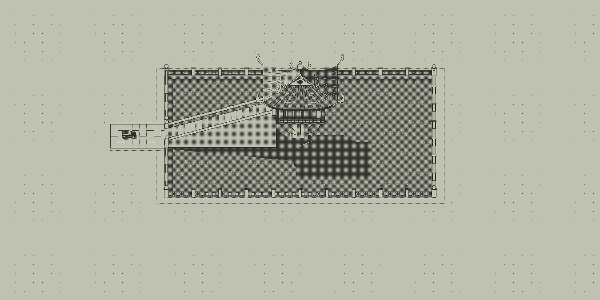
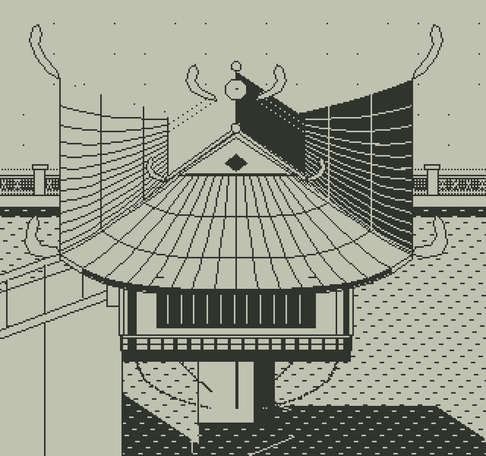
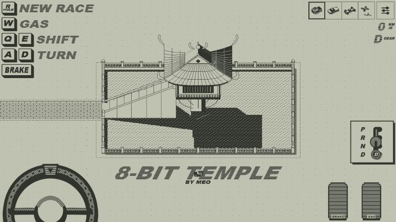
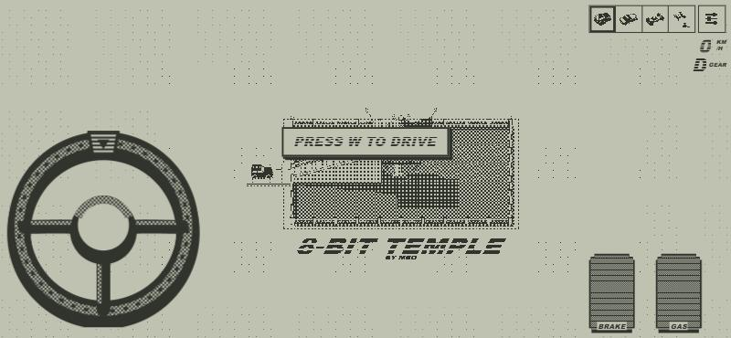
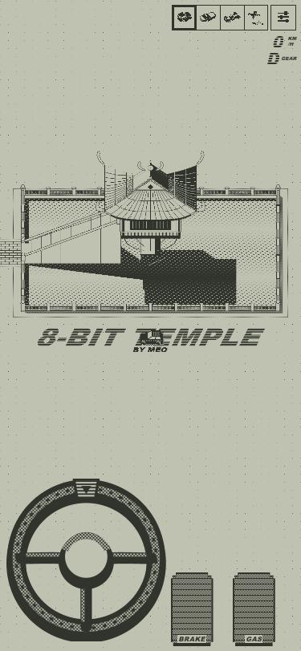
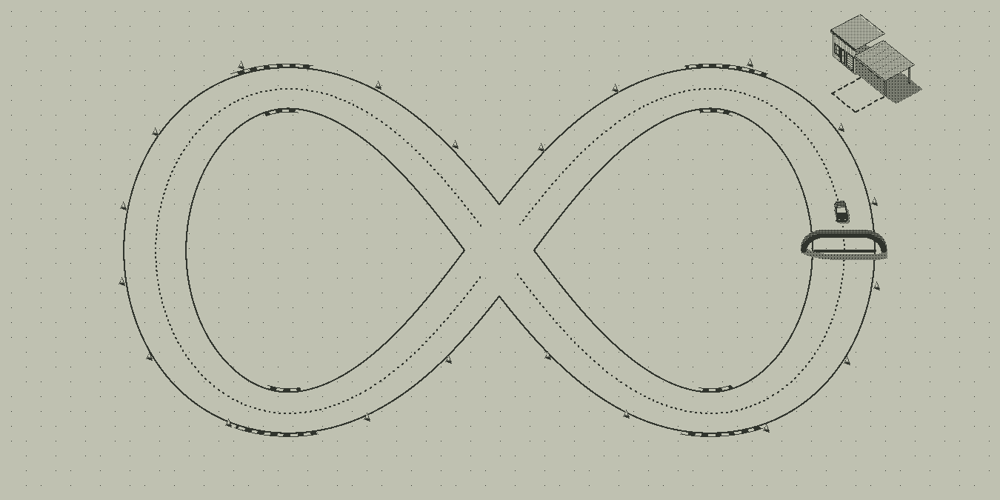
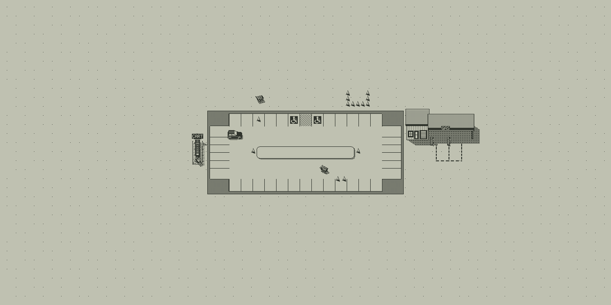

# 8-Bit Drift

A full-screen, two-tone driving playground with timed single-lap races and calm 8-bit music and sound effects. The current game is `dist/index.html`: HTML, CSS, JavaScript, and procedural Canvas artwork in one standalone file. No build, runtime libraries, external assets, fonts, backend, or application network requests are required.

Updated October 30, 2026. The public repository now includes GitHub Pages publishing and GitHub Actions checks. See [Current state](tasks/CURRENT_STATE.md) for game implementation details and [the publishing guide](tasks/GITHUB_PAGES.md) for deployment and verification limits. Earlier task plans and agent handoffs are historical references.

## Play locally

Open `dist/index.html` directly in a browser, or run:

```sh
node preview.cjs
```

Then visit [the local preview](http://127.0.0.1:4173/). The preview reads the saved HTML on each request; refresh after an edit. Local changes do not update the published site automatically.

## Play online and publish updates

**[Play 8-Bit Drift on Vercel](https://8bit-drift.vercel.app/)** or **[on GitHub Pages](https://minhmeonguyen0.github.io/8-Bit-Drift/).** Published and checked on October 30, 2026: the page loads, the on-screen gas pedal starts the race, and the timer advances without console errors. See deployments and checks in [GitHub Actions](https://github.com/MinhMeoNguyen0/8-Bit-Drift/actions).

The publishing flow is:

1. Edit `dist/index.html`, commit, and push your changes. Saving locally alone does not publish.
2. A pull request into `main` runs checks without updating the website. This is **CI (continuous integration)**.
3. Pushing or merging into `main` runs the deployment checks again. If they pass, GitHub uploads only `dist` and updates the website. This is **CD (continuous deployment)**.
4. A failed deployment check stops publication; an already published version remains available. To undo a release, revert its commit on `main` and push.

Publication requires the standalone deployment, broad, current-feature and mobile suites to pass. After deploying, the workflow fetches the live page and checks it is byte-identical to the commit's `dist/index.html`; the run fails if it isn't, and on success its summary says which commit is live. Pages lets browsers cache the page for up to 10 minutes, so hard-refresh to see a new release at once. The separate regression workflow also runs the game suites independently. See [the CI/CD guide](tasks/GITHUB_PAGES.md). No package install, build step, or personal deployment token is required.

**Vercel** is linked to this repository and deploys on its own: every pull request gets a preview deployment, and every push to `main` goes to production at `https://8bit-drift.vercel.app`. Its build command in `vercel.json` runs the same four suites (`verify-deploy`, `verify`, `verify-current`, `verify-mobile`), so a failing check fails the Vercel build and the live site keeps its previous version. Only `dist` is served. After each push to `main`, `.github/workflows/vercel.yml` waits up to ten minutes for the live page to become byte-identical to the commit (so it also fails when Vercel's checks stop the release) and warns if the analytics script is not served. To undo a Vercel release, revert the commit on `main`, or use Instant Rollback in the Vercel dashboard.

**Analytics** (Vercel Web Analytics) is the one deliberate network request. `analyticsOn` in `dist/index.html` loads `/_vercel/insights/script.js` from the page's own origin, only over HTTPS on a `vercel.app` host; direct file opening, the local preview and GitHub Pages make no requests. Enable it in the Vercel project's Analytics tab. If a custom domain is added, extend `analyticsOn` and its test in `verify-deploy.cjs`.

## Controls and vehicles

| Action | Control |
| --- | --- |
| Accelerate | W / Up arrow, or hold the gas pedal |
| Brake | Space, or hold the brake pedal |
| Steer | A / D, Left / Right arrows, or drag the wheel |
| Brake / reverse throttle | S / Down arrow brakes normally; with R engaged it accelerates in reverse |
| Shift | Q / E, or drag the gear stick |
| Pause | Escape; opening Settings or leaving the foreground also pauses |
| Right a stuck ground car | R or the recovery button when available |
| Mute / unmute all sound | M (Settings has separate Music and Effects switches and volumes) |
| Horn | Hold H |

The **Compact** uses a P/R/N/D automatic and starts in Drive. Q moves the automatic selector toward Drive; E moves it toward Park. The **Supercar** is a five-speed manual with reverse below fifth on its H gate; it starts in first. Q from first can select reverse when stopped. Shifts into reverse and Park, and unsafe manual downshifts, are protected. A brake alone never selects reverse.

The **F1 Car** (between the Supercar and the Drone in the chooser) is the fastest ground car and is perfectly planted: its tyres never let go, so it cannot drift or skid, and it never rolls. It has a sequential 8-speed with no clutch and no stick. Like the paddles behind a real F1 wheel, a **downshift paddle (Q, left)** and an **upshift paddle (E, right)** sit either side of a gear display, with a row of eight shift lights above that fills as the revs climb and lights fully when it is time to shift up. One pull is one gear. Reverse is below first (Q from first when stopped), unsafe downshifts are refused, and tapping or clicking a paddle works on touch and mouse as well as Q / E.

On a ground car, hold gas and brake near a standstill to build a burnout, then release the brake while holding gas for a boosted launch.

The **Drone** flies like a real drone on a Mode 2 remote (angle mode with altitude hold) and has no gearbox. Its wheel, pedals and gear stick are replaced by two thumb sticks:

| Drone stick | Keyboard | Effect |
| --- | --- | --- |
| Left stick up / down | W / S | Climb / descend (centred holds the height) |
| Left stick left / right | A / D | Turn on the spot |
| Right stick up / down | Up / Down arrows | Tilt nose down / up to fly forward / back |
| Right stick left / right | Left / Right arrows | Tilt to slide left / right |

The right stick tilts the drone, and the tilted thrust moves it: released, it levels out and drifts to a stop. The readout shows its height (M ALT). It flies over cones and leaves no tyre marks. Gate posts stop it unless it flies above them; at the floor it lands and the other sticks wait for lift-off.

## Races and free drive

Choose **Daily Challenge** (the Signature circuit), **Easy oval**, **Figure eight**, **Temple**, or **Parking lot** in Settings. Temple and Parking lot are free-drive maps without a race. The road courses open in Ready. Tap the playground, press a pedal, or press W / Enter to start the clock. Holding W or the on-screen gas pedal starts and drives in the same gesture. The clock includes the trip from the standard spawn to the gate. The first forward gate crossing arms the lap; complete the route and cross forward again to finish.

The top-center figures show `minutes:seconds:hundredths` and a percentage, side by side in the striped theme. The percentage is **track quality**, a distance budget that falls with off-road travel and never recovers. It is not route completion. Short excursions can rejoin ahead; large route skips still cannot finish the lap. The debug switch in Settings shows the route, cursor, gate state, progress, and off-track distance.

Finishing freezes the game and shows a centered result in the pause-screen style, including elapsed time, percentage, ranked time, and best:

- **Tap to continue** or press Enter to dismiss the result and resume untimed free drive. The race figures disappear.
- **Hold R for 1 second**, or tap the restart button beside the car selector, to reset to the start prompt. A short R press still rights a rolled car.

Opening Settings and dismissing it leaves the game paused. The dismissal click is consumed, including when it lands on the gas pedal. **Reset scene** restores the scene and a fresh Ready race on a road course. Parking stays free drive.

Ranked time is `elapsedSeconds + 0.02 × (100 − quality)²`; lower wins. Personal bests are stored locally per course, vehicle, relevant handling setup, and effective route geometry. Storage failures fall back to session-only bests. Wrapping, teleport recovery, handling changes, or a physical course resize end an active timed attempt; a notice explains the interruption.

## The Temple map

**Temple** is a free-drive map, like the parking lot: no road, race gate, cones or pit garage, and no lap timer. It has only the One Pillar Pagoda (Chùa Một Cột), shown with its own painted title, **8-BIT TEMPLE**. The shrine is shaped like a lotus rising from a square pond. It stands on a single stone pillar, which carries the floor on curved wooden struts. It has a lattice room, a veranda railing, a curved tiled roof with upturned corners, and a small gable on top crowned by a gilt pearl between two dragons. A stone-coped pond with a balustrade fence surrounds it. A short flight of ten broad stairs climbs from a gate in the west fence to the veranda, and a long brick path, laid in running bond, leads to that gate from the west edge of the map.





- Every vehicle, the Drone included, starts on the painted **8-BIT TEMPLE** title, facing west along it.
- The pond and its fence are solid for cars, from every side. The Drone can climb over the fence and fly over the water. It can't fly through the stairs or the shrine, which is taller than it can fly.
- Light falls from the upper left, as everywhere in the game. The water is paper with ink ripple dashes; in shadow it turns to ink with paper ripples. The shrine, pillar, stairs and fence cast these shadows on the water. A flying Drone's shadow falls on the open water too, but adds nothing where the water is already in the temple's shadow (`drawWaterShadow`, `waterShade`). Cars behind the pond or the shrine are hidden by them.
- The stairs come in from the side, because this camera looks down steeply: stairs from the front would hide the pillar. For the same reason, the roof overhangs less at the front than at the sides.
- Sizes are in `TEMPLE_GEO`, and the map is built by `buildTemple`. The temple is drawn at 1.45× on the fixed 1350 × 675 world, centred together with its title.
- On a phone held upright, the Temple map is **not** turned 90° like the road courses: it stays upright, and the camera fits the temple, pond and title between the top bar and the controls (`templeViewBox`, the `upright` camera).

| Desktop (1366×768) | Phone, landscape (844×390) | Phone, portrait (375×812) |
| --- | --- | --- |
|  |  |  |

## Sound and music

Added November 5, 2026. The game has calm 8-bit music and sound effects, and **every sound is made in code** with the browser's Web Audio API: there are no audio files, libraries or downloads, so the game stays one standalone file. The voices copy an old 8-bit console: two pulse waves (12.5%, 25% and 50% width), a triangle for the bass, and noise from a 15-bit shift register. A soft echo on the music, a gentle lowpass over everything and a compressor keep it warm and quiet. The music is deliberately slow (64–92 bpm) and sits behind the driving.

Browsers only allow sound after the player touches the page, so nothing plays until the first tap, click or key.

### What you hear

Each map has its own song. Every song loops through melody passes and "breathers" (no melody, no drums) so it never feels busy. The loops last 1.5 to 3 minutes.

| Map | Song | Feel |
| --- | --- | --- |
| Daily Challenge | **Coast Road** | D major, 84 bpm, a gentle forward roll |
| Easy oval | **Easy Breeze** | G major waltz (3/4), 92 bpm, oom-pah-pah chords |
| Figure eight | **Sunday Loop** | F major, 76 bpm, the default song |
| Temple | **Lotus Pond** | D minor pentatonic, 64 bpm, plucked notes that bend up into pitch like a đàn tranh, a held pad, wood blocks and a bell |
| Parking lot | **Lot Lounge** | C major jazz, 80 bpm, swung, with walking bass and chord stabs |

Changing map cross-fades to the new song. While the game is paused or Settings is open, the music keeps playing but is muffled and quieter; it opens up again when you drive. A hidden tab suspends all sound.

Sounds that follow the car all the time:

| Voice | Behaviour |
| --- | --- |
| Engine (Compact, Supercar, F1) | A soft, layered hum: two copies of the car's own mellow tone a few cents apart for warmth, a sine an octave down for body, a gentle idle putter that smooths out as the revs rise, and a little breath of air on the gas, all through a lowpass that opens with the revs. Pitch and level glide, so it settles down smoothly after each upshift. The Compact purrs, the Supercar has a deeper lope, the F1 Car a smooth high hum. |
| Drone rotors | Two pulses a fifth apart with a fast wobble. Higher when climbing or tilting; they spin down when it lands. |
| Tyres | Noise that hisses in a skid and roars in a burnout. |

One-shot effects:

| Moment | Sound |
| --- | --- |
| Gear change / paddle shift | A short click and clunk (crisper on the paddles) |
| Shift refused | A low double buzz |
| Cone / shopping cart | A soft wooden "bonk" / a metallic clatter, louder for harder knocks |
| Post, wall or temple fence | A thud scaled by the impact |
| Two wheels / rollover / landing | A wobble / a tumbling arpeggio / a thump |
| Car righted | A rising arpeggio |
| Edge wrap | A soft whoosh |
| Drone take-off / touchdown, launch after a burnout | A rising sweep / a soft landing / a rush |
| Race start, gate armed, off the route, run ended | Short chimes in the song's key |
| Finish / new best | A fanfare (longer with sparkle for a new best); the music dips under it |
| Settings, car and track buttons, switches, pause | Quiet blips |
| Horn (hold H) | Two-tone beep, different per car; the Drone chirps |

### Controls and settings

- **Settings → Music / Effects** switch each part on or off.
- **Settings → SOUND** shows what is playing and has Master, Music and Effects volume sliders.
- **M** mutes everything, and pressing it again restores what was on. **Hold H** for the horn (keyboard only).
- Sound settings are saved in the browser under `8bitdrift.audio.v1`, apart from tuning and race records. If storage is blocked, the defaults are used.

### How it is built

All of it lives in `dist/index.html`, in three layers. The physics never knows about sound.

```text
Simulation (pure)      step() also records the last step's hardest knocks: w.impact (posts, walls, temple blocks)
                       and w.knock / w.knockKind (cones, carts). Nothing in the physics reads them.

Sound data and logic   SONGS, SONG_FOR, SONG_VOICES   the music, written as text
(pure, tested in Node) songBar(song, n)               every note of bar n: deterministic
                       JINGLES                        short tunes for game moments, moved into the song's key
                       engineTone / rotorTone / tyreNoise   pitch and level of the continuous voices
                       audioSnapshot → audioEvents    compares two moments and returns events (shift, cone, go, finish…)
                       audioSettings / loadAudio / saveAudio   validated, stored settings

Synth (browser)        createSound(store)             the Web Audio graph, voices, music scheduler, effects, horn

Glue (browser)         soundCollect()  after every physics step: keeps the frame's hardest knock and impact
                       soundFrame()    once a frame: runs audioEvents and feeds the engine, rotors and tyres
                       onModeChange, buttons, keys    muffling, blips, M and H
```

The audio graph:

```text
song → music → echo ─┐
          └──────────┴→ tone (muffles while paused) → master → warm lowpass → compressor → speakers
effects, engine, rotors, tyres, horn → fx ──────────→ master
```

Why it is built this way:

- **No files.** The project allows no shipped media, and synthesis is also tiny: the whole sound system is about 30 KB of code, comments included.
- **Testable.** Songs, events and tone maths are plain functions, so `verify-current.cjs` checks them in Node like the physics.
- **Steady timing.** The music is scheduled 0.4 s ahead on the audio clock, so a slow frame or a busy page never makes it stumble.
- **Events by comparison.** Comparing two snapshots (gear, car state, race state, wraps, knocks) finds every moment without adding sound calls throughout the game code. A new car or a new race only resets the comparison, so changing car never plays a crash.

### Writing or changing music

A song is a few lines of text. Notes are written `c5`, `f#4`, `bb3`; a token `note:length` lasts that many eighth notes (1 when left out) and `.` is a rest. Each line of a phrase is one bar and must add up to the bar length (8 eighths, or 6 for a waltz); the tests check this.

```js
sunday:{name:'Sunday Loop',bpm:76,bar:8,key:5,swing:0,arpUp:0,pad:false,bell:false,form:[-1,0,1,0,-1,1],
 chords:['f2 c3 a3 c4 e4', /* one chord per bar: root, fifth, then the upper voicing */ ...],
 bass:'0:4 1:2 0^:2',        // chord tones by index: root for a half note, fifth, root an octave up
 arp:'2 4 3 4 2 4 3 4',      // eighth-note arpeggio over the upper voicing ('*' strikes it as a chord)
 drums:'k.....h.s.....h.',   // two characters per eighth: k kick, s brush, h hat, w / t wood blocks
 lead:[[ 'c5:3 a4 c5:2 e5:2', /* bar 2 */ ... ], /* phrase 1 */ [ ... ]]}
```

- `form` is the order the phrases play in; `-1` is a breather. `key` (semitones above C) moves the jingles into the song's key. `swing` delays the off-beats (the lounge uses `.3`).
- To add a song, add it to `SONGS`, choose its map in `SONG_FOR`, and optionally give it its own instruments in `SONG_VOICES` (wave, level, envelope, lowpass, vibrato, glide). Then run `node verify-current.cjs`.
- To change an effect, edit its `case` in `effect()` inside `createSound`. To add a new game moment, add it to `audioEvents`, give it a `case`, and add a line to the sound test.
- Keep it calm: slow tempos, soft attacks, pulse waves through a lowpass, and quiet drums.

### Mix levels

Levels were measured by rendering the real synth offline at the default volumes (Master 80%, Music 55%, Effects 75%). The music sits around −21 dBFS RMS. Every vehicle sound (engine, rotors, tyres, horn, knocks, shifts, landings) plays through a vehicle bus at half level (`VEHICLE = .5`, November 6, 2026), so the engine sits about 12 dB under the music at cruise and very softly at idle, skids around −36 dB, and knocks peak around −12 to −16 dB. Race jingles and interface blips are not halved. `LEVEL` in `createSound` raises or lowers everything at once, `ENGINE_LEVEL` the engine, and each voice has its own level.

### What is in, and what is left out

In: music for every map, engine, rotor and tyre sounds, all the effects above, race jingles, interface blips, a horn, pause muffling, mute, volumes and saved settings.

Left out on purpose:

- **Audio files or samples.** They would break the single-file, no-assets rule.
- **Stereo panning and 3D position.** The camera is fixed and the screen is small, so they would add little.
- **Music that speeds up with the car.** It would work against the calm feel.
- **A horn button on phones.** It would need a new on-screen control; on touch screens the horn is not available.
- **Getting around the iPhone silent switch.** iOS mutes Web Audio when the phone is on silent.
- **Different sounds per surface** (grass, brick, water). A possible later addition.

### Verification

Ten sound checks in `verify-current.cjs` cover note parsing, every song's bar lengths and ranges, deterministic looping and breathers, jingles in every key, the engine following the gear load, rotors and tyres, the impact and knock readings (which must not change the physics), event detection, saved settings, and that the page uses no audio files or requests. In the browser, driving on desktop triggered the start chime, gate, shifts, a cone, an edge wrap, a wall bump and the off-route chime; the Drone triggered take-off and touchdown; changing map switched the song; M muted and restored the sound; and the Settings layout was checked at 1280×720, 375×812 and 844×390. The `data-sound` and `data-sound-events` attributes on the game canvas show the audio state and the last events for QA.

Not yet done: listening on real phones (especially iPhone Safari) and on a range of speakers. The levels were measured, not tuned by ear.

## Art style guide

Read this before drawing anything new. Everything on screen is drawn in code, in the same few rules. To see the current art at native pixels, run `node snapshot.cjs` (below) instead of guessing from the source or from a downscaled browser screenshot.

| Figure eight | Parking lot |
| --- | --- |
|  |  |

### Palette and shading

- **Two inks only.** Ink `#30342d` (`INK = [48,52,45]`) and paper `#bfc1b1` (`PAPER = [191,193,177]`). Every sprite pixel is one or the other, fully opaque. Tests check this.
- **Shades are ordered dithers** in `raster()`: `0` solid ink, `.25`, `.5` and `.75` (2×2 Bayer, more paper as the number rises), `1` solid paper.
- **Keep fine dithers to small parts.** A large field of 1-pixel checker breaks into moiré blotches whenever the view is scaled unevenly (phones, shrunk screenshots). Large surfaces use solid ink or paper with sparse lines instead, like the temple's water, roof and walls; a test enforces this for the temple.
- **Shadows** use their own denser 4×4 dither (`shadowPixel`, 55% ink, `SHADOW_INK`), never a shade value.
- **Outlines**: one-pixel ink outlines on filled shapes (`poly(points, shade, true)`). Dotted lines (`line(a, b, .5)`) are used for stone joints and guide markings.
- **Ground**: paper with a sparse grid of single ink dots (`groundDots`). Road edges are 1 px, the centre guide is 2 px dashes.
- Material vocabulary used so far:

| Material | Shade |
| --- | --- |
| Stone tops, paper signs, gilt | `1` with ink outlines, dotted `.5` joints |
| Stone front faces | `.75` |
| Roof tiles | `.5` with ink channel lines |
| Lacquered wood, shaded sides | `.25`, with a `.5` stripe on the lit side |
| Black trim, tyres, windows | `0` |

### Camera, light and depth

- **Fixed oblique camera from the south.** Screen x = world x. Screen y = world y × `K` − `Z` × height, with `K = .66` and `Z = √(1 − K²) ≈ .75`. One world unit across is one screen pixel at default zoom; the fixed world is 1350 × 675 screen px.
- Only faces that point south (+y, toward the viewer) and tops are visible; east and west walls are edge-on. Draw back to front within a sprite.
- **Light comes from the upper left.** Shadows fall down-right by `LIGHT = {x: .45, y: .3}` screen px per unit of height. Make faces toward the light a step (`+.25`) lighter and faces away a step darker.
- Shadows are drawn on the ground first, for everything, before any object. Build a shadow as the convex hull of a footprint swept to its height along `LIGHT` (`hull(...)`, then `poly(..., 0, false, shadowPixel)`).
- **Depth sorting**: each drawable has a `key`, the screen y of its front ground line. Lower keys draw first, and the car wins ties. Anything higher than every car roof (`GATE_SPLIT`) goes in a separate top layer keyed `GATE_FRONT` (or `GATE_FRONT - 1`), so cars pass under it. A Drone flying above `FLY.clear` uses `GATE_FRONT + 1`, except behind the temple's shrine (`templeHides`).
- In-world lettering uses the 5×7 `PROP_LETTERS` glyphs on an ink plate (`propLabel`), as in CART and GAS.

### Adding a structure or course

Use the pit garage (`pitArt`) and the temple (`templeArt`) as templates. Check the camera first: it looks down steeply (`K = .66`), so anything south of an object and higher than it hides it, and wide overhangs hide what is under them:

1. **Geometry in one place.** Define sizes in local units (u right, v south, z up), like `TEMPLE_GEO`, and derive the art, colliders and clearances from them.
2. **Art.** Write a `…Art()` function that returns raw rasters sharing one anchor: a base layer, any top layer, and a shadow layer. Project with `P = (u, v, z) => [ax + u, ay + K * v - Z * z]`. Cache the browser canvases (`templeSprites`, `pitSprites`).
3. **Drawables.** Return `{type, part, x, y, key}` items from a `…Drawables(w)` function, add them in `sceneItems`, and draw the shadow and the parts in `drawShadow` and `drawItem`.
4. **Collisions.** Use circle posts in `layout.posts`, which the Drone clears above `FLY.clear`, or oriented boxes `{x, y, angle, w, d, height}` checked with `pitOverlap`, `carPit` and `conePit` in `step()`. A box stops the Drone below its `height`. Also exclude them in `recoverSpot`.
5. **Course or map.** Add the id and name to `TRACKS`. A road course adds a shape to `TRACK_SHAPES` (unit control points in driving order, `gate: [segment, fraction]`, `asp` range) and a `TRACK_FALLBACK` entry. A free-drive map returns its own layout from `buildCourse`, with `gate: null` and an empty `track.pts`, like `buildParking` and `buildTemple`; no race follows. Give it a painted title (`titleOpts`, `titleRect`) and a Settings thumbnail (`lotThumb`, `templeThumb`).
6. **Check it.** Render it with `snapshot.cjs`, view it in the browser at desktop and phone sizes, add the id to the course loops in the verification scripts, and add focused tests: two-tone sprites, colliders, Drone heights, recovery and depth keys.

### Snapshots

`snapshot.cjs` loads the game's script in Node and draws a course exactly as `draw()` orders it: ground, shadows, sorted sprites. It needs no packages. It leaves out the painted title, the keyboard guide, tyre marks and the DOM controls.

```sh
node snapshot.cjs temple docs/images/temple-map.png
node snapshot.cjs temple docs/images/temple-closeup.png --scale 3 --crop 520,60,840,360
node snapshot.cjs eight docs/images/course-eight.png --at 600,300,0
```

The images in `docs/images` were made this way, except the `ui-*.jpg` interface screenshots, which come from the browser. They are documentation only and are not deployed.

## Appearance and settings

Speed and gear are stacked against the right edge below the selector. On keyboard layouts, the ground-painted keycap guide shows R New Race, W Gas, Q/E Shift, A/D Turn, and Brake. The guide is drawn below tyre marks and vehicles. Narrow/mobile layouts omit this guide. On-screen wheel, pedals, and gear stick remain available.

Settings includes Music and Effects switches, skid visibility, clear tracks, reset scene, race debug mode, race rules, course thumbnails, a collapsible SOUND section with volumes (see [Sound and music](#sound-and-music)), and collapsible tuning. Handling, wheel response, Drone tilt, separate road/parking zoom, burnout, launch, and smoke controls are adjustable. Defaults and ranges are defined in `TUNING_SPEC` in the HTML.

## Development and verification

Node is needed only for helper scripts. Edit `dist/index.html` directly. See [AGENTS.md](AGENTS.md) for repository guidance and [the documentation index](tasks/README.md) for current and historical references.

```sh
node verify-deploy.cjs
node verify-race.cjs
node verify-current.cjs
node verify-mobile.cjs
node verify.cjs
node snapshot.cjs temple docs/images/temple-map.png
```

Latest local results on November 5, 2026 (sound and music added): all suites pass — 144 broad checks plus 10 race groups, 69 current-feature checks (ten of them for sound, seven for the Temple map), 15 mobile checks and three deployment checks. The formerly failing checks were audited and migrated to current behavior; actual gate, drone-pad and F1 skid defects were fixed. See [the regression audit](tasks/REGRESSION_AUDIT.md) for the exact changes.

Browser checks covered 1366×768, 864×930, 390×844, 844×390, and 320×568. Short drives, pause, and on-screen gas were exercised; a landscape instruction/prompt overlap was fixed. A simulated-finish fixture exercised the centered result, mobile restart, and tap-to-free-drive. A full lap through actual browser controls, physical-device multitouch, safe-area hardware, long-session performance, and direct-file browser validation remain outstanding. Do not treat this as a full green QA signoff.

The static deployment contains only `dist/index.html`. `.github/workflows/pages.yml` publishes the game to GitHub Pages, Vercel publishes it through `vercel.json`, `.github/workflows/vercel.yml` confirms the Vercel release, and `.github/workflows/regression.yml` reports the broader tests. `.gitignore` excludes local assistant/editor configuration, hosting metadata, environment files, dependencies, and generated output. It deliberately keeps `dist` tracked because that is the source. Documentation, verification scripts, and historical task files stay in the repository but are excluded from the website upload. Ignoring or untracking a file does not erase it from earlier commits.

## References

The visual reference is [Daily Driver (Tech Demo)](https://gingerbeardman.itch.io/daily-driver). All shipped artwork is generated in code. The clutch-free manual design was informed by [Forza's transmission modes](https://forums.forza.net/t/meet-the-most-accessible-forza-motorsport-ever/597587/38) and downshift protection by [GT7](https://us.gran-turismo.com/us/gt7/news/00_3200508.html).
